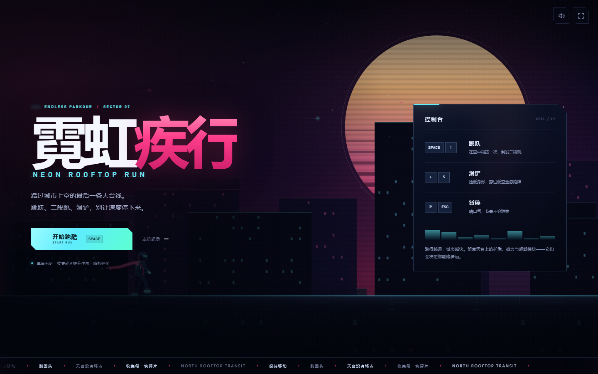
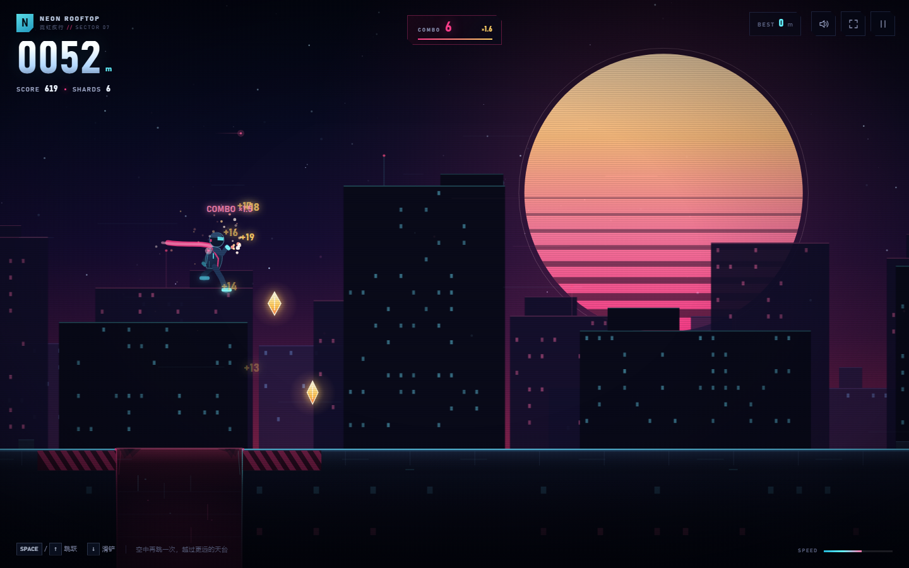

# 霓虹疾行 · NEON ROOFTOP RUN

一款离线可玩的霓虹天台跑酷小游戏。跳跃、二段跳、滑铲，在无尽的城市天际线之间收集能量碎片，跑得越远，城市越快。

## 最快开始

**Windows：双击 `开始游戏.bat`。**

其他方式：

1. 双击 `index.html`，用浏览器打开；
2. 在 VS Code 中右键 `index.html`，选择 **Open with Live Server**（需安装对应扩展）。

游戏不需要安装依赖、不需要联网，也不使用任何 CDN 资源。

## 画面预览





## 目录说明

```text
neon-parkour/
├── 开始游戏.bat          # Windows 双击启动
├── index.html            # 游戏唯一入口
├── README.md             # 本说明
├── css/
│   └── style.css         # 菜单、HUD、响应式布局
├── js/
│   └── game.js           # Canvas 渲染、物理、关卡生成、音效
└── images/
    ├── preview-menu.png  # 菜单截图
    └── preview-game.png  # 实玩截图
```

日常游玩只需要用到 `开始游戏.bat` / `index.html`；其余文件是游戏本身的资源，不要删除。

## 操作

| 操作 | 桌面端 | 触屏 |
| --- | --- | --- |
| 跳跃 | `Space` / `↑` / `W` / 鼠标点击 | 轻触屏幕 / 「跳跃」按钮 |
| 二段跳 | 空中再次跳跃 | 空中再次轻触 / 上滑 |
| 滑铲 | `↓` / `S`（按住可延长） | 下滑 / 「滑铲」按钮 |
| 暂停 | `P` / `Esc` | 右上角暂停按钮 |
| 重开 | 结算页按 `R` | 结算页「再来一次」 |
| 声音 | `M` | 右上角声音按钮 |
| 全屏 | `F` | 部分设备支持右上角全屏按钮 |

## 玩法规则

- **跑得越远，速度越快。** 距离会转化为分数，同时逐渐提高城市的滚动速度。
- **跳跃高度固定。** 所有可跳障碍都低于一次完整跳跃的弧线；空中还能再跳一次，用来修正落点或跨过更宽的断崖。
- **金币按真实跳跃抛物线排列。** 在金币串起点起跳，就能跟着弧线一次收满整串。
- **滑铲**可穿过低空全息路障和巡逻无人机。滑铲时仍能收集低处的碎片。
- **能量碎片**增加连击。连击越高，每块碎片的分值越高；短暂停止收集会中断连击。
- **断崖**会直接结束本局；护盾无法救回，但超载疾行期间会自动生成能量桥。
- **随机强化：**
  - **相位护盾**：可叠加，最多储存 3 层；每层抵挡一次撞击，破裂后短暂无敌。
  - **磁力收束**：一段时间内自动吸取附近碎片。
  - **超载疾行**：持续 **30 秒**，速度提升到普通状态的 **3 倍**。期间自动磁吸、撞碎障碍并免疫全部伤害，跨越断崖时会形成能量桥。剩余约 1.8 秒和 0.55 秒时会用提示音、屏幕边缘和 HUD 闪烁提醒；结束后还有 0.8 秒无敌缓冲。
- **所有强化道具的出现频率约翻倍**（生成间隔缩短一半）；类型比例保持 **疾行 : 护盾 : 磁力 = 3 : 1 : 1**，即 60% / 20% / 20%。
- 每 250 米触发一次里程奖励。
- 最高距离与最高分会自动保存在浏览器本地。

## 想继续调整

- 跳跃高度、重力、障碍尺寸：`js/game.js` 中的 `applyScale()` 与 `OBSTACLE_SPECS`。
- 金币抛物线：`js/game.js` 中的 `addJumpArc()`。
- 护盾叠加上限、超载时长/速度/预警：`js/game.js` 中的 `SHIELD_MAX`、`BOOST_DURATION`、`BOOST_SPEED_MULT`、`BOOST_WARN_TIME`、`BOOST_FINAL_WARN_TIME`。
- 强化道具出现频率/比例：`js/game.js` 中的 `POWERUP_FIRST_DISTANCE`、`POWERUP_SPAWN_MIN`、`POWERUP_SPAWN_MAX` 与 `addPickup()`。
- 配色、菜单和 HUD：`css/style.css` 顶部的变量与对应区块。

## 说明

- 已适配桌面、手机竖屏和横屏；触屏设备会自动显示跳跃与滑铲按钮。
- 音效由 Web Audio API 实时合成，没有额外音频文件。
- 切换到后台或窗口失焦时**不会自动暂停**；只有按 `P` / `Esc` 或点击暂停按钮才会暂停。浏览器可能降低后台动画帧率，切回页面后会从当前进度直接继续。
- 存档使用 `localStorage`；隐私模式或禁用本地存储时仍可游玩，只是不保存最高纪录。
- 如果浏览器拦截了自动播放，点击「开始跑酷」后音效会正常工作。

祝你在天台上跑得足够远。
